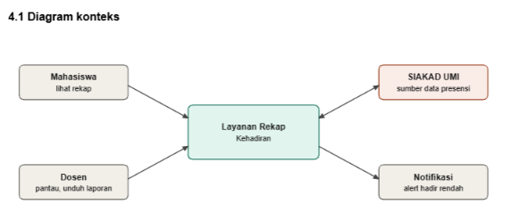
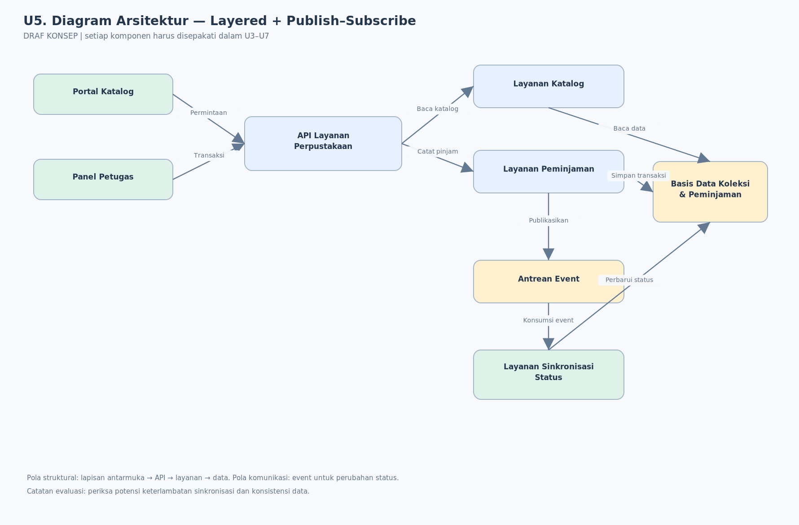
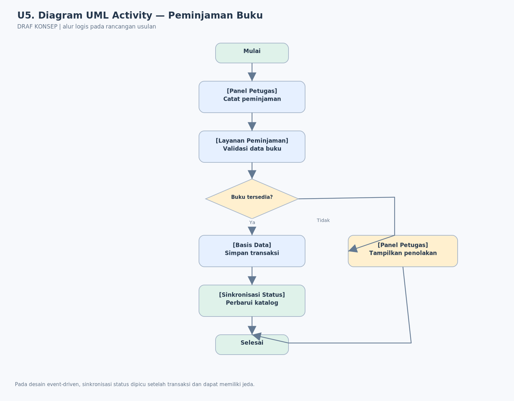

\# U5. Desain dan Diagram

**BAB IV:** Desain  
**Penanggung jawab:** [Nama Anggota / Penanggung Jawab Bagian U5]  

**Ketentuan dosen:** minimal **3 diagram** (konteks, arsitektur yang menerapkan pola, UML), masing-masing berketerangan, serta **3 prinsip desain** yang diterapkan.

**PENTING:** Diagram PNG dan `.drawio` yang disertakan adalah **CONTOH RANCANGAN AWAL**. Semua komponen/arah hubungan harus disepakati kelompok, konsisten dengan U3/U4/U6/U7, dan belum berarti telah diimplementasikan.

---

## 4.1 Diagram Konteks

**Keterangan Komponen Konteks:**
* **Mahasiswa:** Pengguna yang mengakses sistem untuk melihat ringkasan/rekapitulasi kehadiran lintas mata kuliah secara terpusat.
* **Dosen:** Pengguna yang memantau tingkat keaktifan mahasiswa, melakukan validasi presensi, serta mengunduh laporan rekap kehadiran kelas.
* **Layanan Rekap Kehadiran:** Subsistem usulan yang bertugas mengumpulkan, memproses, dan menyajikan data presensi secara terpadu.
* **SIAKAD UMI:** Sistem akademik utama universitas yang bertindak sebagai sumber data master presensi dan jadwal perkuliahan.
* **Notifikasi:** Modul pendukung untuk mengirimkan *alert* atau peringatan otomatis apabila tingkat kehadiran mahasiswa berada di bawah batas minimum.

---

## 4.2 Diagram Arsitektur yang Menerapkan Pola

**Keterangan Alur Arsitektur:**
Diagram di atas merepresentasikan penerapan pola arsitektur *microservices* dan *layered* pada layanan rekap kehadiran UMI, di mana komunikasi data diatur melalui lapisan terstruktur untuk menghindari beban berlebih pada basis data utama SIAKAD.

---

## 4.3 Diagram UML (Activity / Sequence)

**Keterangan Alur UML:**
Diagram ini memetakan alur aktivitas (*activity workflow*) proses pemeriksaan dan pembaruan status kehadiran mahasiswa di dalam sistem usulan.

---

## 4.4 Tiga Prinsip Desain yang Diterapkan

1. **Single Responsibility Principle (SRP):** Setiap layanan mikro memiliki satu fokus tanggung jawab fungsional yang spesifik agar mudah dipelihara.
2. **Layered & Decoupled Access:** Pemisahan akses langsung ke sistem SIAKAD utama universitas guna melindungi integritas data master.
3. **Performance Optimization:** Penerapan strategi pemrosesan data yang efisien untuk memastikan waktu muat rekap kehadiran cepat dan responsif.
